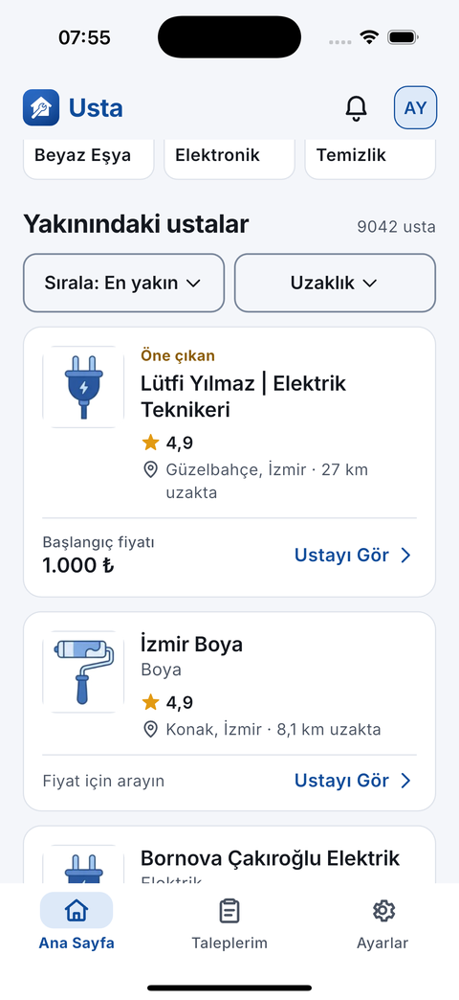
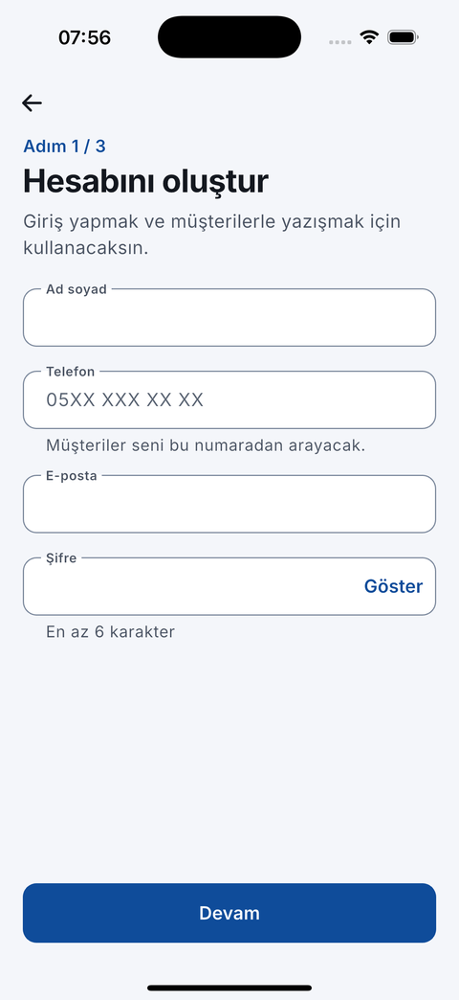
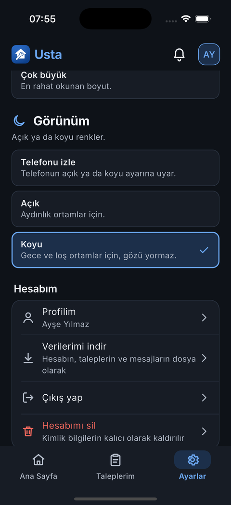

<div align="center">

# Usta

**Yakınındaki ustayı bul, karşılaştır, ara ya da uygulamadan yaz.**
Elektrik, su tesisatı, klima, boya, dekorasyon, marangoz, beyaz eşya, elektronik ve temizlik için Türkçe öncelikli yerel hizmet platformu.

*A Turkish-first local-services marketplace: Flutter client, NestJS API, MongoDB Atlas (9 000+ real providers).*


</div>

---

## İçindekiler

1. [Neden Usta?](#neden-usta)
2. [Kimin için?](#kimin-için)
3. [Özellikler](#özellikler)
4. [Ekranlar](#ekranlar)
5. [Tasarım ilkeleri (UI / UX)](#tasarım-ilkeleri-ui--ux)
6. [Mühendislik ilkeleri](#mühendislik-ilkeleri)
7. [Mimari](#mimari)
8. [Güvenlik, gizlilik ve sorumluluk](#güvenlik-gizlilik-ve-sorumluluk)
9. [Kalite güvencesi ve testler](#kalite-güvencesi-ve-testler)
10. [Kurulum ve çalıştırma](#kurulum-ve-çalıştırma)
11. [API özeti](#api-özeti)
12. [Proje yapısı](#proje-yapısı)
13. [Bilinen sınırlar ve yol haritası](#bilinen-sınırlar-ve-yol-haritası)

---

## Neden Usta?

Usta bulmak çoğu insan için hâlâ "bir tanıdık sormak" demek. İlan siteleri kalabalık, filtre dolu ve yaşlı ya da acelesi olan biri için yorucu. Usta şu soruya tek cevap verir:

> **Hangi ustaya ihtiyacın var?** → bir resme dokun → sana en yakın ustaları gör → ara ya da yaz.

- **Tek filtre modeli.** Ana sayfada sadece resimli hizmet kutuları var. Ayrı "kategori / alt kategori / filtre" ekranları yok.
- **Konum altyapıdır, sekme değil.** İlk açılışta konum bir kez istenir; "Bornova, İzmir" gibi anlaşılır bir adla gösterilir. Harita sekmesi yoktur; "Yol Tarifi" telefondaki harita uygulamasını açar.
- **Gerçek veri.** 9 042 gerçek usta kaydı MongoDB Atlas'tan servis edilir. Olmayan fiyat uydurulmaz: "Fiyat için arayın" yazar.
- **Uygulama içi yazışma.** WhatsApp ya da SMS'e geçmek zorunda değilsin: sohbet, fotoğraf, yanıtla, düzenle, sil ve hazır mesajlar uygulamada. İstersen yine de WhatsApp'a yönlendirir.
- **Dürüst sorumluluk modeli.** "Sahibinden usulü": Usta bir ilan ve iletişim platformudur; iş, ödeme ve anlaşmazlık taraflar arasındadır. Şikayet, veri indirme ve resmi başvuru yolları uygulamanın içindedir.

## Kimin için?

| Kullanıcı | İhtiyacı | Usta'nın cevabı |
|---|---|---|
| **Müşteri** (evde arıza, tadilat, temizlik) | Hızlı, güvenilir, yakın usta | Resimli hizmet seçimi, mesafeye göre sıralama, puan, fiyat listesi, adres, tek dokunuşla arama |
| **Usta / esnaf** | Müşteri bulmak, iş takibi | Usta kaydı (zorunlu bilgiler + isteğe bağlı fiyat listesi), gelen talepler, kabul/iş bitti, sohbet |
| **50+ yaş ve düşük teknoloji rahatlığı olanlar** | Büyük yazı, az adım, net dil | Arayüz Boyutu (Normal / Büyük / Çok büyük), 3 sekme, büyük dokunma alanları, Türkçe sade metin |
| **Gece / loş ortam kullanıcıları** | Göz yormayan ekran | Açık, Koyu ya da telefonu izleyen tema |

## Özellikler

**Keşif**
- Resimli hizmet kutuları (Elektrik, Su Tesisatı, Klima & Kombi, Boya, Dekorasyon, Marangoz, Beyaz Eşya, Elektronik, Temizlik); seçince sonuçlara kayar, tekrar dokununca kalkar.
- Arama (ad / hizmet), sıralama (en yakın / puana göre), uzaklık sınırı, il seçimi.
- Konum satırı: ters coğrafi kodlama ile ilçe, il. İzin yoksa sadece o zaman "Konumumu kullan" uyarısı.

**Usta sayfası**
- Kimlik, puan, mesafe → **Adres** ve Yol Tarifi → Fiyat listesi → Yapılan işler → Yorumlar.
- Birincil eylem **Ara**; ikincisi **Mesaj Gönder**: Uygulamadan yaz / WhatsApp'tan yaz / SMS ile yaz.

**Mesajlaşma ve talepler**
- İlk mesaj otomatik: `Hizmet Talebi: <yazdığın>`.
- Sağa kaydırarak yanıtla (iki taraf için), kendi mesajını düzenle ve sil, fotoğraf gönder, hizmete özel hazır mesajlar, üst çubukta Ara.
- Taleplerim: talep adı büyük, usta adı ikincil; durum cümleleri "Ustaya iletildi", "Usta kabul etti", "İş tamamlandı".

**Hesap**
- İlk açılışta 3 sayfalık tanıtım, ardından **Usta arıyorum** / **Ustayım, iş arıyorum** kayıtları.
- Usta kaydı 3 adım: hesap → işletme bilgileri (hizmet, il, dükkân/seyyar, hakkında) → isteğe bağlı fiyatlar ve onaylar.
- Sağ üstte sabit bildirim ve profil düğmeleri; alt gezinme: **Ana Sayfa · Taleplerim · Ayarlar**.

**Ayarlar**
- Arayüz Boyutu, Görünüm (Açık / Koyu / Telefonu izle), hesap, **Verilerimi indir**, çıkış, hesabı sil.
- Destek, uygulama rehberi, güvenli iletişim rehberi, **Şikayet ve resmi başvurular** (e-Devlet Tüketici Hakem Heyeti, Ticaret Bakanlığı, ALO 175, 155), Kullanıcı Sözleşmesi, KVKK Aydınlatma Metni, Sorumluluk Reddi.

## Ekranlar

| Karşılama | Ana sayfa | Sonuçlar | Usta sayfası |
|:---:|:---:|:---:|:---:|
|  |  |  |  |

| İletişim seçenekleri | Sohbet | Taleplerim | Usta kaydı |
|:---:|:---:|:---:|:---:|
|  |  |  |  |

| Ayarlar | Resmi başvurular | Koyu tema | Koyu ayarlar |
|:---:|:---:|:---:|:---:|
|  |  |  |  |

## Tasarım ilkeleri (UI / UX)

| İlke | Uygulamada nasıl görünür |
|---|---|
| **Hick–Hyman yasası** (seçenek azsa karar hızlıdır) | Ana sayfada tek filtre modeli: 9 resimli kutu. Alt gezinmede yalnızca 3 hedef. Usta sayfasında tek birincil eylem. |
| **Fitts yasası** (büyük ve yakın hedef kolay vurulur) | Dokunma alanı en az 48 dp (Büyük'te 56, Çok büyük'te 64). Bildirim ve profil her ekranda sağ üstte aynı yerde; birincil düğmeler tam genişlik ve başparmak bölgesinde. |
| **Tanımak, hatırlamaktan iyidir** | Hizmetler kelimeyle birlikte özgün, tek stilde çizilmiş resimlerle gösterilir. Durumlar yalnızca renk değil, simge + cümle ile verilir. |
| **Erişilebilirlik** | WCAG AA kontrast (testle doğrulanır, hem açık hem koyu palet), `Semantics` etiketleri, sistem yazı boyutu × Usta Arayüz Boyutu birlikte ölçeklenir, 320 dp genişlikte 1,5× yazıyla taşma yok. |
| **Dürüst arayüz** | Uydurma fiyat, sahte "doğrulandı" rozeti yok. "Öne çıkan" ücretli yerleşimdir ve öyle yazılır. Yazışmaların kayıt altında olduğu sohbette hep görünür. |
| **Özgün görsel dil** | Mavi tonlarda tek aile: birincil `#0F4C9A`, arka plan `#F4F6FA`. Yarıçaplar yalnızca 8 / 12 / 16 / 24 (hap şekilli etiket yok). Inter yazı tipi (pakete gömülü, çevrimdışı çalışır). Özel ikon ailesi, Gemini ile üretilmiş resimler. |
| **Kademeli ifşa** | Tanıtım 3 sayfa; kayıt 3 adım; hata mesajları ne olduğunu ve ne yapılacağını söyler. |
| **Dil** | Sade, sıcak, doğru Türkçe ("sen" dili, cümle düzeni ve ek uyumu gözden geçirildi). |

## Mühendislik ilkeleri

- **Katmanlı mimari ve tek yönlü veri akışı.** `UI → controller (Riverpod) → repository → data source → API`. Widget'lar ağı ya da depolamayı bilmez.
- **Soyutlama ve değiştirilebilirlik.** Sunucuda `Store<T>` arayüzü (`MemoryStore` / `MongoStore`); `DATA_SOURCE=mock|mongo` ile veritabanı olmadan da çalışır. İstemcide konum, yer adı ve depolama arayüzlerle enjekte edilir, testlerde sahteleriyle değiştirilir.
- **Tek doğruluk kaynağı.** Renkler, yarıçaplar, boşluklar, tipografi, hizmet listesi, ikonlar tek yerde (`AppColors`, `AppRadius`, `AppSpacing`, `AppTypography`, `kServices`, `UstaIcons`). Widget'larda ham renk kodu yok.
- **Hata yönetimi.** Ağ, zaman aşımı ve sunucu hataları `AppFailure` ile kullanıcıya anlaşılır Türkçe mesaj olur; ham istisna hiçbir zaman ekrana basılmaz.
- **Performans.** İlk kare konum, ağ ya da veritabanı beklemez. Listeler sayfalıdır ve kaydırmada yüklenir; resimler hedef boyutta çözümlenir (`cacheWidth`); sohbet ve talepler hafif yoklama ile yenilenir.
- **Gizliliğe göre tasarım.** Sırlar yalnızca gitignore'lu `server/.env` içindedir; kimlik silme, veri dışa aktarma ve şikayet kaydı uygulamanın parçasıdır.
- **Geliştirici deneyimi.** `flutter analyze` temiz, `dart format`, Jest ve Flutter testleri, tek komutla kurulum, `progress.md` ile devam edilebilir iş günlüğü.

## Mimari

```
┌──────────────────────────┐   REST/JSON    ┌──────────────────────────────┐    ┌─────────────────┐
│ Flutter (iOS / Android)  │ ─────────────▶ │ NestJS modüler monolit       │ ─▶ │ MongoDB Atlas   │
│ Riverpod · go_router     │                │ accounts · conversations     │    │ usta_db         │
│ Dio · SharedPreferences  │ ◀───────────── │ providers · orders · privacy │    │ (veya bellek)   │
└──────────────────────────┘                │ complaints · attachments …   │    └─────────────────┘
                                            └──────────────────────────────┘
```

- **İstemci:** `lib/app` (yönlendirme, açılış) · `lib/core` (tema, erişilebilirlik, ikonlar, ağ, ortak widget'lar) · `lib/features/*` (özellik başına ekran + controller) · `lib/data` (model, repository, uzak veri kaynağı).
- **Sunucu:** `server/src/*` modülleri; her biri Memory ve Mongo deposu ile çalışır (`StoreFactory`).
- **Kimlik (mock):** `MOCK_AUTH` açıkken hesaplar cihazda tutulur (tuzlu SHA-256), sunucuya yalnızca hesap profili yazılır. Bkz. [Sınırlar](#bilinen-sınırlar-ve-yol-haritası).

## Güvenlik, gizlilik ve sorumluluk

- **Sırlar:** MongoDB bağlantısı yalnızca `server/.env` içindedir (`.gitignore`'da, repo'ya ve belgelere girmez). `.env.example` sadece boş yer tutucular içerir.
- **KVKK ve şeffaflık:** Mesajların güvenlik ve anlaşmazlık süreçleri için sunucuda saklandığı, gerektiğinde taraflarla paylaşılabileceği; sohbette, kayıtta ve KVKK Aydınlatma Metni'nde açıkça yazar.
- **Veri hakları:** Ayarlar → **Verilerimi indir** hesap, talep ve mesajları JSON olarak paylaşır; **Hesabımı sil** kimlik bilgilerini kaldırır (mesaj ve şikayet kayıtları kimliksiz saklanır).
- **Şikayet:** Usta sayfasından ve sohbetten, nedenli, takip numaralı şikayet; ardından resmi merciler (e-Devlet Tüketici Hakem Heyeti, Ticaret Bakanlığı, ALO 175, 155).
- **Sorumluluk reddi:** Platform işin yapılması, ödeme, dolandırıcılık ve anlaşmazlıklarda taraf değildir.
- ⚠️ Hukuki metinler **taslaktır**; yayına almadan önce bir avukat incelemelidir.

## Kalite güvencesi ve testler

| Katman | Kapsam | Sonuç |
|---|---|---|
| Flutter birim + widget + duman testleri | 97 test: doğrulayıcılar, mesafe, hizmet eşleştirme, fiyat kuralları, modeller, auth ve admin geçişi, sohbet denetleyicisi, keşif akışı, 3 sekme (Harita yok), Arayüz Boyutu, **koyu tema canlı geçişi**, tanıtım akışı, usta sayfası bölüm sırası (adres → fiyat), iletişim seçenekleri | ✅ |
| Erişilebilirlik | Açık ve koyu paletin WCAG AA kontrast testi; 320 dp × 1,5× sistem yazısı × Büyük / Çok büyük için taşma testleri | ✅ |
| Sunucu | 23 Jest testi: sohbet (düzenle / sil / yanıtla / okundu), durum geçişleri, depo soyutlaması | ✅ |
| Gerçek veritabanı | Atlas'ta uçtan uca duman testi (usta listesi, filtre, detay, talep, sohbet) ve gerçek hata yakalama (geo anahtarı) | ✅ |
| Cihaz | iPhone 16 Pro simülatörü ve gerçek iPhone | ✅ |

```bash
flutter analyze && flutter test
cd server && npm test && npm run build
```

## Kurulum ve çalıştırma

**Gereksinimler:** Flutter 3.x, Node 20+, (isteğe bağlı) MongoDB Atlas hesabı.

```bash
# 1) Sunucu (veritabanı olmadan örnek veriyle)
cd server
cp .env.example .env          # DATA_SOURCE=mock ile başlar
npm install
npm run start

# 2) Uygulama
cd ..
flutter pub get
flutter run --dart-define=API_BASE_URL=http://localhost:3000
```

**Gerçek veritabanı:** `server/.env` içinde `DATA_SOURCE=mongo`, `MONGODB_URI` ve `DATABASE_NAME=usta_db` değerlerini yerelde doldurun. Bu dosya asla commit edilmez. Bağlantıyı sınamak için `npm run db:check` (sır yazdırmaz).

**Gerçek iPhone:** Mac ve telefon aynı ağdayken `--dart-define=API_BASE_URL=http://<Mac-LAN-IP>:3000`.

### Deneme girişi (mock auth)

Geliştirme ve gösterim için herhangi bir giriş ya da kayıt alanına **`admin`** yazmak doğrulamayı geçirir:

- Giriş ekranında: demo hesap oluşturulur / kullanılır.
- Usta kaydında: tüm alanlar varsayılanlarla doldurulur ve `isDemo` işaretli bir usta oluşur.

Bu geçiş varsayılan olarak açıktır; kapatmak için `--dart-define=MOCK_AUTH=false`. Gerçek kimlik doğrulama (SMS / e-posta doğrulaması) yol haritasındadır.

### Test verisini temizleme

```bash
cd server && npm run db:cleanup-test simtest-    # belirtilen önekle başlayan test kayıtlarını siler
```

## API özeti

| Alan | Uç noktalar |
|---|---|
| Ustalar | `GET /providers` (filtre, arama, sıralama, konum) · `GET /providers/:id` · `POST /providers` · `PATCH /providers/:id` · `POST/DELETE /providers/:id/photos` |
| Yorumlar | `GET/POST /providers/:providerId/reviews` |
| Talepler | `POST/GET /service-requests` · `PATCH /service-requests/:id/status` |
| Sohbet | `GET /conversations/:id` · `GET/POST /conversations/:id/messages` · `POST /conversations/:id/read` · `POST /conversations/:id/attachments` · `PATCH/DELETE /messages/:id` · `GET /attachments/:id` |
| Hesap | `PUT /accounts` · `GET /accounts/:id` · `GET /privacy/export` · `DELETE /privacy/account` |
| Şikayet | `POST/GET /complaints` |
| Diğer | `GET /categories` · `GET /notifications` · `GET /users/:id` · `GET /health` |

## Proje yapısı

```
lib/
  app/          yönlendirme, açılış, tema geçişi
  core/         theme (palet, tipografi, boşluk), accessibility (UiScale), icons, network, widgets, utils
  data/         models, repositories, datasources
  features/     auth · chat · discovery · home · location · notifications · orders · profile
                provider · reviews · safety · settings · shell
server/src/     accounts · attachments · categories · common · complaints · conversations
                notifications · orders · privacy · providers · reviews · users
assets/         services (Gemini ile üretilmiş), onboarding, brand
docs/screenshots/
```

## Bilinen sınırlar ve yol haritası

- **Kimlik doğrulama gerçek değil (mock).** Sunucu istemcinin gönderdiği kimliğe güvenir; yayından önce SMS/e-posta doğrulaması ve sunucu tarafı oturum (JWT) gerekir.
- **Ödeme yok.** "Öne çıkan" plan şimdilik bilgi ve e-posta yönlendirmesidir.
- **Anlık bildirim yok.** Sohbet ve talepler yoklama ile yenilenir (3 sn / 15 sn); FCM/APNs sonraki adım.
- **Veri kalitesi.** Atlas verisinde bazı konumlar şehirle uyuşmaz, çoğu kayıtta fotoğraf ve fiyat yoktur; arayüz bunu uydurmadan "Fiyat için arayın" ile gösterir.
- **Hukuki metinler taslaktır** ve avukat incelemesi bekler.
- Yol haritası: gerçek kimlik doğrulama, anlık bildirim, ustalar için görsel yükleme akışı, App Store / Play Store imzalama, sayfalı yorum ve puanlama.

---

<div align="center">

Özenle tasarlandı, uçtan uca test edildi. Sorular ve katkılar için bir *issue* açın.

</div>
