<div align="center">

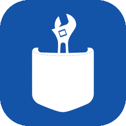

# Usta

**Yakınındaki ustayı bul, karşılaştır, ara ya da uygulamadan yaz.**<br>
Elektrik, su tesisatı, klima, boya, dekorasyon, marangoz, beyaz eşya, elektronik ve temizlik için<br>Türkçe öncelikli, ustaların cebinde taşıdığı yerel hizmet platformu.

[](https://flutter.dev)
[](https://nestjs.com)
[](https://www.mongodb.com/atlas)


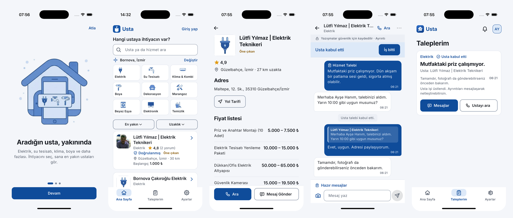

</div>

---

## İçindekiler

1. [Neden Usta?](#neden-usta) · 2. [Kimin için?](#kimin-için) · 3. [Özellikler](#özellikler) · 4. [Usta hesabı](#usta-hesabı) · 5. [Ekranlar](#ekranlar)
6. [HCI ilkeleri](#insanbilgisayar-etkileşimi-hci-ilkeleri) · 7. [Görsel tasarım dili](#görsel-tasarım-dili) · 8. [Yazılım mühendisliği ilkeleri](#yazılım-mühendisliği-ilkeleri)
9. [Mimari](#mimari) · 10. [Güvenlik ve gizlilik](#güvenlik-ve-gizlilik) · 11. [Kalite güvencesi](#kalite-güvencesi) · 12. [Kurulum](#kurulum-ve-çalıştırma) · 13. [API](#api-özeti) · 14. [Yol haritası](#bilinen-sınırlar-ve-yol-haritası)

---

## Neden Usta?

Usta bulmak çoğu insan için hâlâ "bir tanıdığa sormak" demek. İlan siteleri kalabalık, filtre dolu; aceleyle ya da yaşlı biri için yorucu. Usta tek soruya tek cevap verir:

> **Hangi ustaya ihtiyacın var?** → bir resme dokun → yakınındaki ustaları gör → ara ya da yaz.

- **İlk ekranda hem hizmet hem usta.** Küçük resimli dokuz hizmet kutusu ve hemen altında yakındaki ustalar: tek ekranda "ne" ve "kim" birlikte görünür.
- **Tek filtre modeli.** Ayrı kategori, alt kategori ve filtre ekranları yok.
- **Konum altyapıdır, sekme değil.** İlk açılışta bir kez izin istenir; "Bornova, İzmir" gibi anlaşılır bir adla gösterilir. Harita sekmesi yoktur, "Yol Tarifi" telefonun harita uygulamasını açar.
- **Gerçek veri.** 9 000'den fazla gerçek usta kaydı MongoDB Atlas'tan gelir. Olmayan fiyat uydurulmaz: "Fiyat için arayın" yazar.
- **Uygulama içi yazışma.** Sohbet, fotoğraf, yanıtla, düzenle, sil ve hizmete özel hazır mesajlar uygulamada; istenirse WhatsApp'a ya da SMS'e yönlendirir.
- **Dürüst sorumluluk modeli.** Usta bir ilan ve iletişim platformudur; iş, ödeme ve anlaşmazlık taraflar arasındadır. Şikayet, veri indirme ve resmi başvuru yolları uygulamanın içindedir.

## Kimin için?

| Kullanıcı | İhtiyacı | Usta'nın cevabı |
|---|---|---|
| **Müşteri** (arıza, tadilat, temizlik) | Hızlı, güvenilir, yakın usta | Resimli hizmet seçimi, mesafeye göre sıralama, puan, fiyat listesi, adres, tek dokunuşla arama |
| **Usta / esnaf** | Müşteri bulmak, işi takip etmek | Kendi iş paneli: gelen talepler, tek dokunuşla kabul, profil, fiyat listesi, fotoğraflar, "Öne çıkan" |
| **50+ yaş, düşük teknoloji rahatlığı** | Büyük yazı, az adım, sade dil | Arayüz Boyutu (Normal / Büyük / Çok büyük), 3 sekme, büyük dokunma alanları |
| **Gece / loş ortam** | Göz yormayan ekran | Açık, Koyu ya da telefon varsayılanı |

## Özellikler

**Keşif** · Resimli hizmet kutuları (seçince sonuçlar güncellenir, tekrar dokununca kalkar), ad / hizmet araması, sıralama (en yakın / puana göre), uzaklık sınırı, il seçimi. Konum satırı ilçe ve ili gösterir; izin yoksa yalnızca o zaman "Konumumu kullan" uyarısı çıkar.

**Usta sayfası** · Kimlik, puan, mesafe → **Adres** ve Yol Tarifi → Fiyat listesi → Yapılan işler → Yorumlar. Birincil eylem **Ara**, ikincisi **Mesaj Gönder** (Uygulamadan yaz / WhatsApp / SMS).

**Mesajlaşma ve talepler** · İlk mesaj otomatik `Hizmet Talebi: …`; sağa kaydırarak yanıtla, kendi mesajını düzenle / sil, fotoğraf gönder, hazır mesajlar, "Usta kabul etti" / "İş bitti" durumları, okunmamış sayacı.

**Hesap** · Sunucuda saklanan gerçek hesaplar: müşteri ya da usta olarak kayıt, e-posta veya telefonla giriş. (SMS / e-posta doğrulaması sonraki adım; bkz. [yol haritası](#bilinen-sınırlar-ve-yol-haritası).)

**Ayarlar** · Arayüz Boyutu, Görünüm (Açık / Koyu / Telefon varsayılanı), **Verilerimi indir**, hesabı sil, destek, rehber, güvenli iletişim, **Şikayet ve resmi başvurular** (e-Devlet Tüketici Hakem Heyeti, Ticaret Bakanlığı, ALO 175, 155), Kullanıcı Sözleşmesi, KVKK Aydınlatma Metni, Sorumluluk Reddi.

## Usta hesabı

Usta olarak girince uygulama farklı bir yüz gösterir: müşteri araması yok, **iş paneli** var. Usta kendi sayfasını aramalarda görmez ve kendine talep gönderemez.

| Sekme | Ne yapar |
|---|---|
| **Panel** | Yeni talep / mesaj / puan özeti, yanıt bekleyenler (tek dokunuşla Kabul et), "Sayfanı tamamla" listesi, öne çıkma durumu |
| **Talepler** | Yeni · Devam eden · Biten gruplarında gelen kutusu, kabul / uygun değilim, sohbet, müşteriyi ara |
| **Sayfam** | Profil fotoğrafı, iş fotoğrafları, tanıtım, hizmet bölgesi / adres, fiyat listesi, tamamlanma yüzdesi, "Müşteri gözüyle gör" |
| **Ayarlar** | Boyut, görünüm, hesap, yasal metinler |

<p align="center">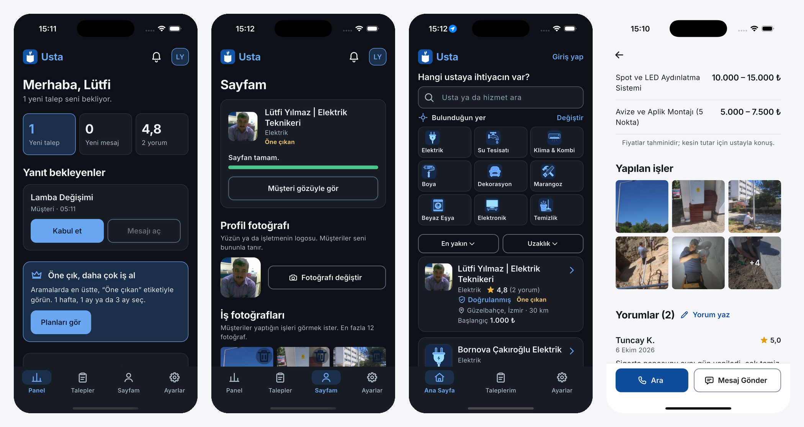</p>

### Öne çıkan (ücretli yerleşim)

Ustalar süreye göre aramalarda en üstte, "Öne çıkan" etiketiyle görünebilir; süre bitince normal sıraya dönerler. Plan uzadıkça günlük fiyat düşer:

| Plan | Fiyat (KDV dahil) | Günlük |
|---|---|---|
| 1 hafta | 99 ₺ | 14,14 ₺ |
| 1 ay | 249 ₺ | 8,30 ₺ |
| 3 ay | 599 ₺ | 6,66 ₺ |

Sunucu planları satar, çalışan promosyonun üstüne ekler ve satın alımı kaydeder (`PAYMENTS_MODE=test` iken ücret alınmaz ve uygulama bunu açıkça söyler; mağaza satın alma doğrulaması için bkz. [docs/RELEASE.md](docs/RELEASE.md)). Plan, iş ya da müşteri sayısı garantisi vermez; metinlerde de öyle yazar.

## Ekranlar

| Karşılama | Ana sayfa | Usta sayfası | Sohbet |
|:---:|:---:|:---:|:---:|
| 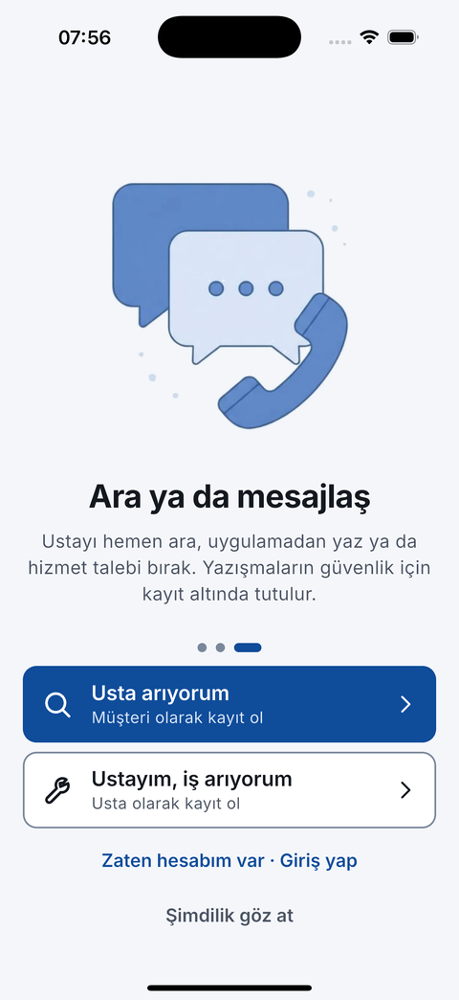 | 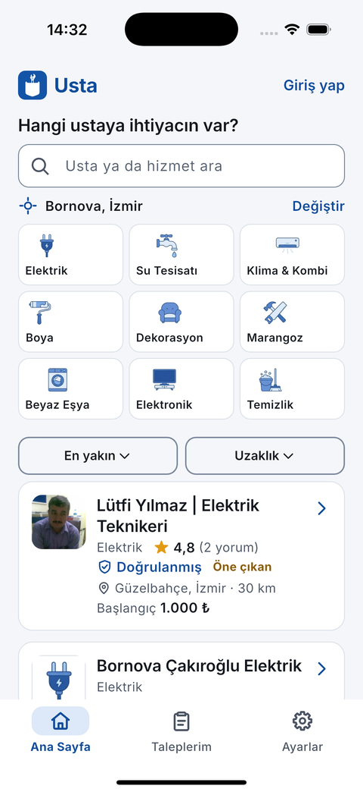 | 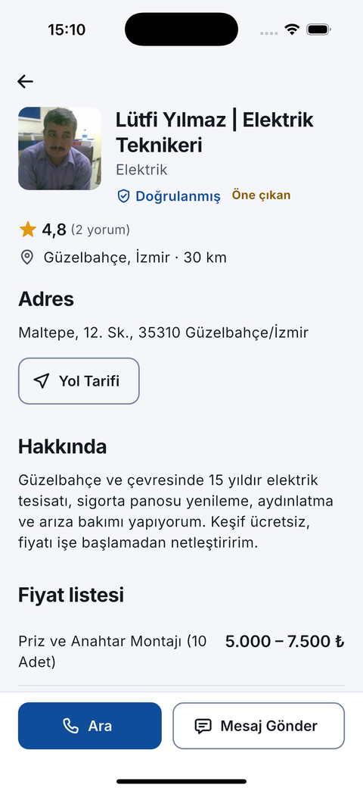 | 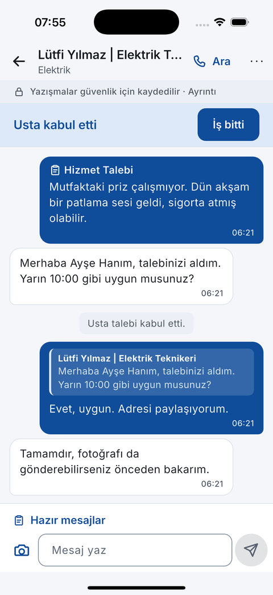 |

| Taleplerim | İletişim seçenekleri | Ayarlar | Resmi başvurular |
|:---:|:---:|:---:|:---:|
| 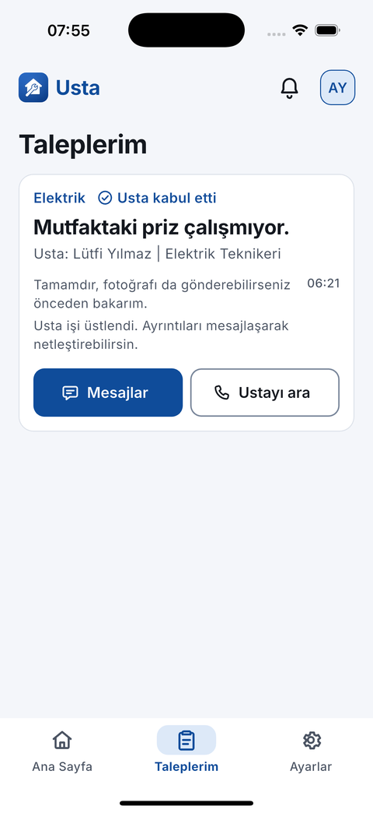 | 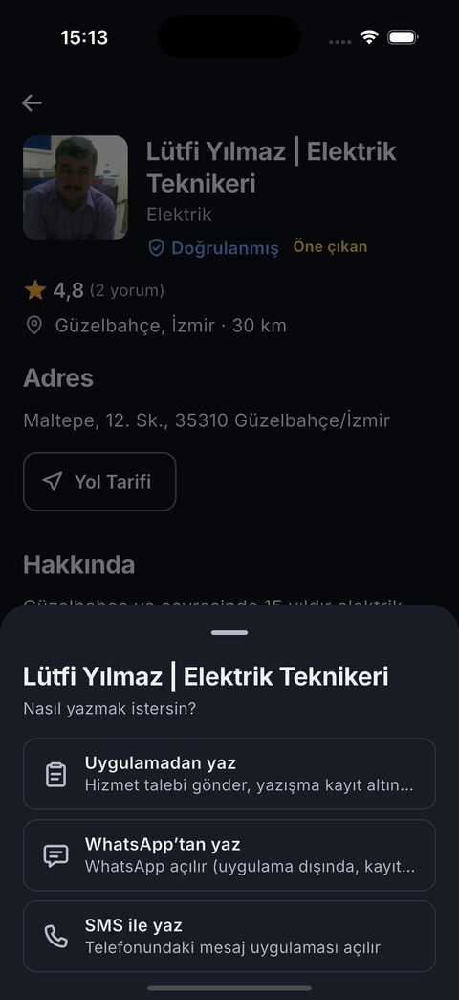 | 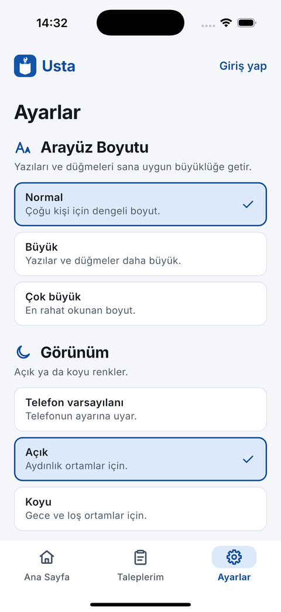 | 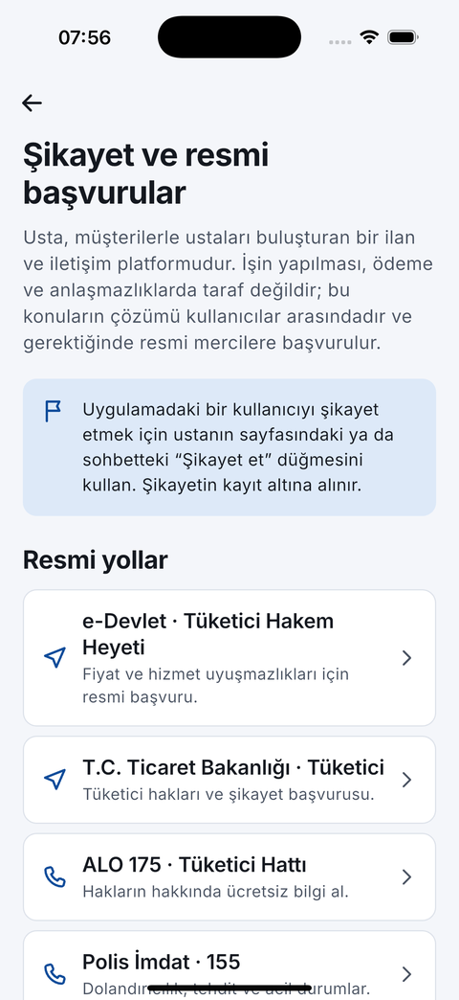 |

| Koyu ana sayfa | Koyu sonuçlar | Usta paneli | Öne çık |
|:---:|:---:|:---:|:---:|
| 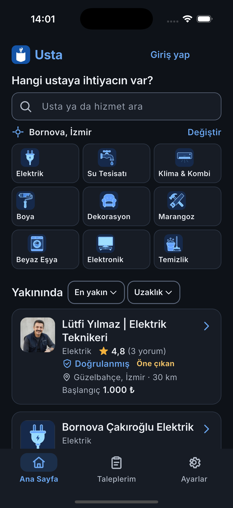 | 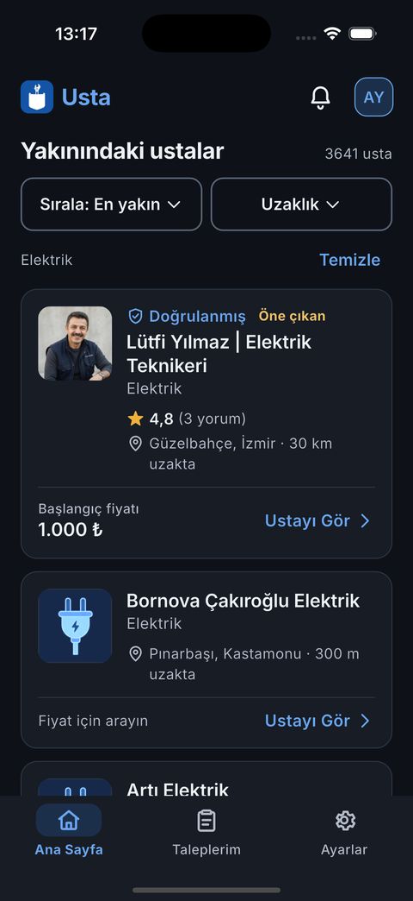 | 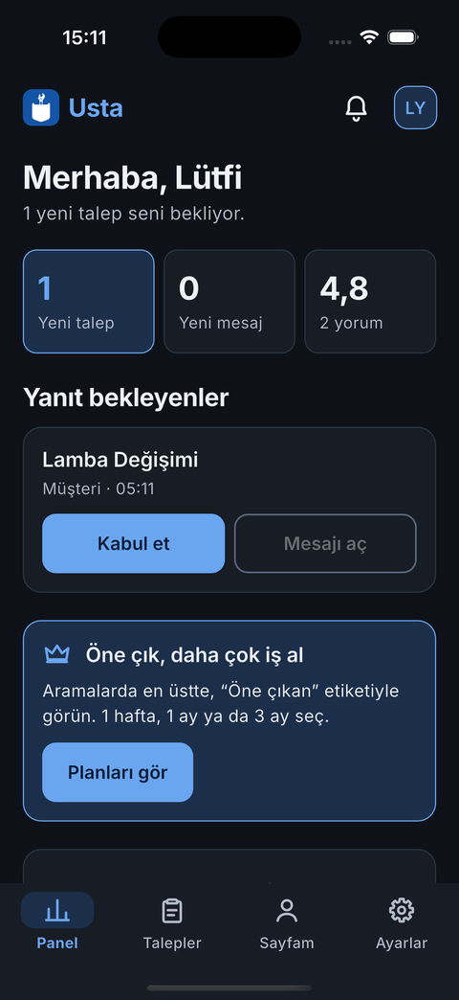 | 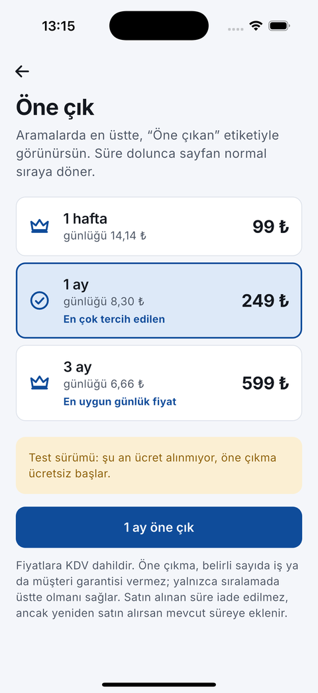 |

## İnsan–bilgisayar etkileşimi (HCI) ilkeleri

| İlke | Usta'da nasıl uygulandı |
|---|---|
| **Hick–Hyman yasası** (seçenek azaldıkça karar hızlanır) | Alt gezinmede 3 (usta için 4) hedef; ana sayfada tek filtre modeli; usta sayfasında tek birincil eylem ("Ara"). |
| **Fitts yasası** (büyük ve yakın hedef kolay vurulur) | Dokunma alanı ≥ 48 dp (Büyük'te 56, Çok büyük'te 64); bildirim ve profil her ekranda sağ üstte aynı yerde; birincil düğmeler tam genişlikte ve başparmak bölgesinde; sıralama ve uzaklık düğmeleri ekranın iki yarısını dengeli doldurur. |
| **Miller yasası / öbekleme** | Usta sayfası beş net bölüme, kayıt üç adıma, ayarlar dört gruba bölünür. |
| **Jakob yasası** (alışkın kalıplar) | Alt sekme çubuğu, geri oku, aşağı çekip yenile, sohbette sağa kaydırıp yanıtla, standart paylaşım ve harita davranışları. |
| **Tanımak, hatırlamaktan iyidir** | Her hizmet kelimeyle birlikte resimle gösterilir; durumlar yalnızca renkle değil simge + cümleyle verilir. |
| **Kademeli ifşa** | Tanıtım 3 sayfa, usta kaydı 3 adım, fiyat listesi isteğe bağlı; ayrıntı gereken yerde açılır. |
| **Hata önleme ve kurtarma** (Nielsen) | Yanlış şifre, kullanılmış e-posta, konum izni yok, ağ yok: her biri ne olduğunu ve ne yapılacağını söyleyen Türkçe mesajla; ham hata ekrana basılmaz. |
| **Sistemin durumunu göster** | İskelet yükleme kartları, okunmamış rozetleri, "Ustaya iletildi / Usta kabul etti" durum cümleleri, test modunda ücret alınmadığının açıkça yazılması. |
| **Erişilebilirlik (WCAG AA)** | Kontrast testle doğrulanır (açık + koyu palet); `Semantics` etiketleri; sistem yazı boyutu × Usta Arayüz Boyutu birlikte ölçeklenir; 320 dp genişlikte 1,5× yazıyla taşma yok. |
| **Dürüstlük** (karanlık desenlerden kaçınma) | Uydurma fiyat ya da sahte "doğrulandı" rozeti yok; "Öne çıkan" ücretli yerleşimdir ve öyle yazılır; yazışmaların kayıt altında olduğu sohbette hep görünür. |
| **Gestalt: yakınlık ve hizalama** | Aynı bilgi aynı kartta, aynı kenar boşluğuyla; "Giriş yap" ve "Değiştir" aynı sağ kenarda biter; ayar açıklamaları tek satırdır. |
| **Dil ve ton** | Sade, sıcak, "sen" dili; ek uyumu ve cümle düzeni gözden geçirildi; sayı ve para birimi Türkçe biçimde. |

## Görsel tasarım dili

- **Mavi aile.** Birincil `#0F4C9A`, arka plan `#F4F6FA`; koyu temada `#6AA6F0` üzerine `#0E1218`. Renkler tek yerde (`AppColors` / `AppPalette`), widget'larda ham renk kodu yok.
- **Şekil.** Yarıçaplar yalnızca 8 / 12 / 16 / 24; hap şekilli etiket yok. İnce çizgi, az gölge.
- **Tipografi.** Inter (pakete gömülü, çevrimdışı çalışır), cümle düzeni, 12,5–28 sp.
- **İkonlar.** Özel SVG yol ailesi (`UstaIcons`), tek çizgi kalınlığı.
- **Görseller.** Gemini ile üretilmiş, tek stilde hizmet çizimleri ve tanıtım resimleri. Koyu temada çizimler derin mavi zeminde açık mavi çizgilerle yeniden renklendirilir (`ArtImage`).
- **İkon.** "Usta cebinde": cepten çıkan İngiliz anahtarı; düz mavi zemin, beyaz şekil, karenin tamamını doldurur.

## Yazılım mühendisliği ilkeleri

- **Katmanlı mimari, tek yönlü veri akışı.** `UI → controller (Riverpod) → repository → data source → API`. Widget'lar ağı ya da depoyu bilmez.
- **SOLID.** Tek sorumluluk (ekran / denetleyici / depo ayrı), bağımlılığı tersine çevirme (konum, yer adı, depolama arayüzlerle enjekte edilir), açık–kapalı (yeni hizmet = `kServices`'e bir satır).
- **DRY ve tek doğruluk kaynağı.** Renk, boşluk, tipografi, ikon, hizmet listesi, plan listesi tek yerde.
- **Değiştirilebilir altyapı.** Sunucuda `Store<T>` arayüzü (`MemoryStore` / `MongoStore`); `DATA_SOURCE=mock|mongo` ile veritabanı olmadan da çalışır.
- **Güvenli varsayılanlar.** Sunucu tarafı kimlik doğrulama ve yetkilendirme guard'ı, sınırlandırılmış giriş denemesi, sırlar yalnızca ortam değişkenlerinde (twelve-factor).
- **Hata yönetimi.** Her hata `AppFailure` ile kullanıcıya anlaşılır Türkçe mesaj olur.
- **Performans.** İlk kare konum, ağ ya da veritabanı beklemez; listeler sayfalı; görseller hedef boyutta çözülür; sohbet ve talepler hafif yoklamayla yenilenir.
- **Test piramidi.** Çok sayıda hızlı birim testi, bunların üstünde bileşen ve duman testleri, gerçek veritabanıyla uçtan uca doğrulama.
- **Sürdürülebilirlik.** `flutter analyze` temiz, `dart format`, `progress.md` ile devredilebilir iş günlüğü, `docs/RELEASE.md` ile yayın kontrol listesi.

## Mimari

```
┌──────────────────────────┐   REST + Bearer    ┌──────────────────────────────┐    ┌─────────────────┐
│ Flutter (iOS / Android)  │ ─────────────────▶ │ NestJS modüler monolit       │ ─▶ │ MongoDB Atlas   │
│ Riverpod · go_router     │                    │ auth · accounts · providers  │    │ usta_db         │
│ Dio · SharedPreferences  │ ◀───────────────── │ orders · conversations       │    │ (veya bellek)   │
└──────────────────────────┘                    │ promotions · complaints …    │    └─────────────────┘
                                                └──────────────────────────────┘
```

- **İstemci:** `lib/app` (yönlendirme, açılış, tema) · `lib/core` (tema, erişilebilirlik, ikonlar, ağ, ortak widget'lar) · `lib/features/*` (özellik başına ekran + denetleyici) · `lib/data` (model, repository, veri kaynağı).
- **Sunucu:** `server/src/*` modülleri; her biri bellek ve Mongo deposuyla çalışır (`StoreFactory`).

## Güvenlik ve gizlilik

- **Kimlik doğrulama:** Şifreler sunucuda **scrypt + rastgele tuz** ile saklanır; oturum, HMAC-SHA256 imzalı, süreli belirteçtir. Telefonda şifre saklanmaz. Her korumalı istek `Authorization: Bearer` taşır; sunucu, isteği yapan kişinin kendi kimliğiyle işlem yaptığını doğrular (başkası adına talep, sohbet, dışa aktarma, silme reddedilir). Aynı hesap için art arda hatalı giriş geçici olarak kilitlenir.
- **Sırlar:** Veritabanı bağlantısı ve `AUTH_SECRET` yalnızca `server/.env` içindedir (`.gitignore`'da). `.env.example` boş yer tutucular içerir.
- **KVKK ve şeffaflık:** Mesajların güvenlik ve anlaşmazlık süreçleri için sunucuda saklandığı, gerektiğinde taraflarla paylaşılabileceği sohbette, kayıtta ve KVKK metninde açıkça yazar.
- **Veri hakları:** **Verilerimi indir** (hesap, talep, mesaj, şikayet) ve **Hesabımı sil** (kimlik kaldırılır, kayıtlar kimliksiz saklanır).
- **Şikayet:** Nedenli, takip numaralı şikayet; ardından resmi merciler.
- **Sorumluluk reddi:** Platform işin yapılması, ödeme ve anlaşmazlıklarda taraf değildir.
- ⚠️ Hukuki metinler **taslaktır**; yayından önce bir avukat incelemelidir.

## Kalite güvencesi

| Katman | Kapsam | Sonuç |
|---|---|---|
| Flutter birim / bileşen / duman | **111 test**: doğrulayıcılar, mesafe, hizmet eşleştirme, fiyat kuralları, modeller, oturum ve kayıt akışı, keşif, ilk ekranda iki usta, 3–4 sekme, Arayüz Boyutu, **koyu tema canlı geçişi**, usta paneli ve plan satın alma, kendi sayfa kuralları, usta kaydında konum | ✅ |
| Erişilebilirlik | Açık ve koyu paletin WCAG AA kontrast testi; 320 dp × 1,5× yazı × Büyük / Çok büyük için taşma testleri (müşteri ve usta ekranları) | ✅ |
| Sunucu | **37 Jest testi**: hesap, giriş, kilitleme, belirteç, yetki guard'ı, sohbet, durum geçişleri, depo, promosyonlar | ✅ |
| Gerçek veritabanı | Atlas'ta uçtan uca duman testi (kayıt, giriş, korumalı uç noktalar, liste, filtre, talep, sohbet) | ✅ |
| Cihaz | iPhone 16 Pro simülatörü ve gerçek iPhone | ✅ |

```bash
flutter analyze && flutter test
cd server && npm test && npm run build
```

## Kurulum ve çalıştırma

**Gereksinimler:** Flutter 3.x, Node 20+, (isteğe bağlı) MongoDB Atlas.

```bash
# 1) Sunucu (veritabanı olmadan örnek veriyle)
cd server
cp .env.example .env          # DATA_SOURCE=mock ile başlar
npm install
npm run start

# 2) Uygulama
cd ..
flutter pub get
flutter run --dart-define=API_BASE_URL=http://localhost:3000
```

**Gerçek veritabanı:** `server/.env` içinde `DATA_SOURCE=mongo`, `MONGODB_URI`, `DATABASE_NAME=usta_db` ve `AUTH_SECRET` (`openssl rand -hex 32`) değerlerini yerelde doldurun. Bu dosya asla commit edilmez. Bağlantıyı sınamak için `npm run db:check` (sır yazdırmaz).

**Gerçek iPhone:** Mac ve telefon aynı ağdayken `--dart-define=API_BASE_URL=http://<Mac-LAN-IP>:3000`.

**Derleme:** `flutter build apk --release` · `flutter build appbundle --release` · `flutter build ipa --release` (aynı `--dart-define`). Mağaza hazırlığı: [docs/RELEASE.md](docs/RELEASE.md), mağaza metinleri: [docs/store/listing-tr.md](docs/store/listing-tr.md).

**Veri araçları:** `npm run db:cleanup-test <önek>` test kayıtlarını siler (`@simtest.local` e-postalı hesaplar dahil); `npm run db:seed-demo -- <providerId>` bir usta sayfasını fotoğraf ve yorumlarla doldurur (fotoğraflar `server/seed-media/` içinden okunur, git'e girmez).

## API özeti

| Alan | Uç noktalar |
|---|---|
| Kimlik | `POST /auth/register` · `POST /auth/login` · `POST /auth/upgrade` · `GET /auth/me` |
| Hesap | `GET/PATCH /accounts/:id` · `GET /privacy/export` · `DELETE /privacy/account` |
| Ustalar | `GET /providers` (filtre, arama, sıralama, konum, `excludeId`) · `GET /providers/:id` · `PATCH /providers/:id` · `POST/DELETE /providers/:id/photos` · `POST /providers/:id/profile-photo` |
| Yorumlar | `GET/POST /providers/:providerId/reviews` |
| Talepler | `POST/GET /service-requests` · `PATCH /service-requests/:id/status` |
| Sohbet | `GET /conversations/:id` · `GET/POST /conversations/:id/messages` · `POST /conversations/:id/read` · `POST /conversations/:id/attachments` · `PATCH/DELETE /messages/:id` · `GET /attachments/:id` |
| Öne çıkma | `GET /promotions/plans` · `POST /providers/:id/promotions` |
| Şikayet | `POST/GET /complaints` |
| Diğer | `GET /categories` · `GET /notifications` · `GET /health` |

Herkese açık okumalar (usta listesi ve detayı, yorumlar, planlar, fotoğraflar, sağlık) oturumsuz çalışır; diğer her şey geçerli oturum ister.

## Proje yapısı

```
lib/
  app/        yönlendirme, açılış, tema geçişi
  core/       theme (palet, tipografi, boşluk), accessibility (UiScale), icons, network, widgets, utils
  data/       models, repositories, datasources
  features/   auth · chat · discovery · location · notifications · orders · profile
              provider · reviews · safety · settings · shell · studio (usta paneli)
server/src/   accounts · attachments · auth · categories · common · complaints · conversations
              notifications · orders · privacy · promotions · providers · reviews · users
assets/       services (Gemini), onboarding, brand
docs/         screenshots, RELEASE.md, store/
```

## Bilinen sınırlar ve yol haritası

- **SMS / e-posta doğrulaması yok.** Hesaplar doğrudan veritabanına kaydolur; doğrulama (ve şifre sıfırlama) sıradaki adımdır.
- **Ödeme test modunda.** "Öne çıkan" planları çalışır ama ücret alınmaz; App Store / Google Play satın alma doğrulaması bağlanmalıdır.
- **Anlık bildirim yok.** Sohbet ve talepler yoklamayla yenilenir (3 sn / 15 sn); FCM / APNs sonraki adımdır.
- **Veri kalitesi.** Atlas verisinde bazı konumlar şehirle uyuşmaz, çoğu kayıtta fotoğraf ve fiyat yoktur; arayüz bunu uydurmadan gösterir.
- **Hukuki metinler taslaktır** ve avukat incelemesi bekler.
- Yol haritası: doğrulama ve şifre sıfırlama, anlık bildirim, mağaza satın alma doğrulaması, yorum yönetimi, App Store / Play Store yayını.

---

<div align="center">

Özenle tasarlandı, uçtan uca test edildi.

</div>
